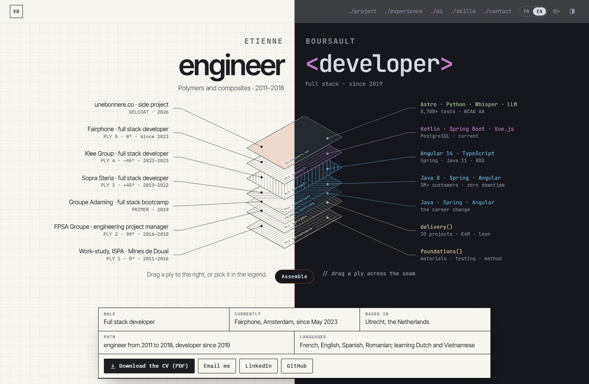
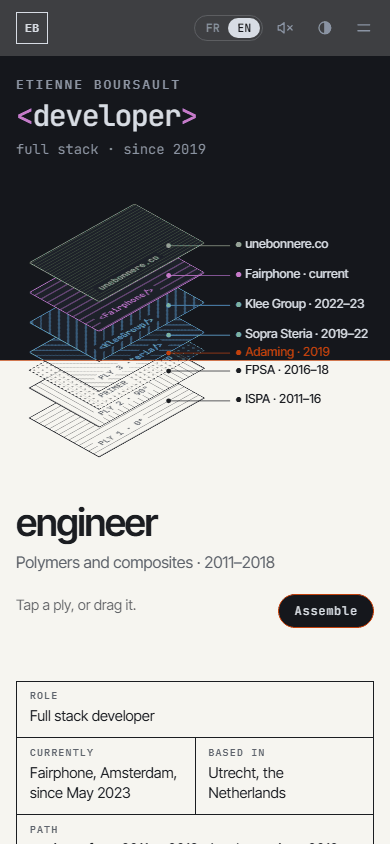

<h1 align="center">engineer | &lt;developer&gt;</h1>

<p align="center">
  The CV of Etienne Boursault, drawn as an exploded view.<br>
  <a href="https://etienne-boursault.github.io/CV/"><b>etienne-boursault.github.io/CV</b></a>
  &nbsp;·&nbsp; <a href="file/pdf/Etienne_Boursault-Resume.pdf">PDF (English)</a>
  &nbsp;·&nbsp; <a href="file/pdf/Etienne_Boursault-CV.pdf">PDF (français)</a>
</p>

<p align="center">
  <a href="https://etienne-boursault.github.io/CV/">
    <picture>
      <source media="(prefers-color-scheme: dark)" srcset=".github/apercu-sombre.png">
      
    </picture>
  </a>
</p>

*Version française plus bas.*

## The idea

I spent 2011 to 2018 as a polymer engineer (thermoplastic injection moulding, then automotive project management) and have been a full stack developer since 2019. The site tells that story the way an engineer would draw it: **a composite laminate in exploded view**, one ply per job.

- The page is split by a **seam**. On the left, the plies are read as an engineer would read them: paper, hatching, ply angles. On the right, the same plies are read as a developer would: editor colours, stacks, function names.
- The 2019 bootcamp sits exactly on the seam as a thin **primer**, the bonding layer that holds two different materials together.
- The top coat, the **gelcoat**, is my current side project, [unebonnere.co](https://unebonnere.co).
- On a phone the seam turns horizontal: you read the laminate from the surface (development) down to the base (engineering).

<p align="center"></p>

## What's inside

- **Plies you can pull.** Drag one across the seam, flick it, or pick it in the legend. The motion uses interruptible springs in the style of Apple's damping-and-response model: every animation starts from what is on screen, inherits the pointer's velocity, and can be grabbed back mid-flight.
- **Accessibility built in.** The legend entries are real buttons, so the view works with a keyboard and a screen reader. *Reduced motion* shows the exploded state without animation, and *reduced transparency* removes the blur.
- **Two languages in one page.** The site opens in French if the browser is in French and in English otherwise, and remembers the visitor's choice. `?lang=fr` or `?lang=en` forces either one.
- **Light and dark themes.** The dark theme turns the paper into a blueprint.
- **Sound** is off by default. When switched on, it plays two short clicks, triggered by the action that causes them.
- **The PDF comes from the page itself**, through a print stylesheet. Site and PDF share a single source of text, and each PDF fits on two A4 pages.
- **No framework, no build step, no dependency.** Plain HTML, CSS and JavaScript, plus three Google Fonts: Inter Tight, IBM Plex Mono and JetBrains Mono.

## Files

```
index.html             every text, in French and English (elements tagged lang="fr" / lang="en")
css/cv.css             screen styles, phone layout and print stylesheet
js/cv.js               exploded view (the plies' texts live in the PLIS array), language, theme, sound
outils/generer-pdf.sh  regenerates both PDFs with headless Chrome
file/pdf/              Etienne_Boursault-CV.pdf (French), Etienne_Boursault-Resume.pdf (English)
```

## Working on it

Open `index.html` in a browser; nothing needs to be installed. After changing a text in `index.html` or `js/cv.js`, regenerate the PDFs:

```bash
bash outils/generer-pdf.sh          # set CHROME=/path/to/chrome if it is not found
```

Pushing to `main` publishes the site through GitHub Pages.

---

## Version française

Le CV d'Etienne Boursault, dessiné en vue éclatée : [etienne-boursault.github.io/CV](https://etienne-boursault.github.io/CV/).

**L'idée.** J'ai été ingénieur en polymères de 2011 à 2018 (injection thermoplastique, puis pilotage de projets automobiles), et je suis développeur full stack depuis 2019. Le site raconte ce parcours comme un ingénieur le dessinerait : **un stratifié composite en vue éclatée**, un pli par poste.
- Une **couture** partage la page : à gauche, la lecture d'ingénieur (papier, hachures, orientation des plis) ; à droite, la lecture de développeur (couleurs d'éditeur, technologies, noms de fonctions).
- La formation de 2019 est posée sur la couture comme un **primaire d'accrochage**, la couche mince qui fait tenir deux matériaux différents.
- La couche de surface, le **gelcoat**, est mon projet personnel [unebonnere.co](https://unebonnere.co).
- Sur téléphone, la couture devient horizontale.

**Ce qu'il y a dedans.**
- **Des plis qu'on peut tirer**, avec des ressorts interruptibles qui reprennent la vitesse du geste.
- **Des légendes qui sont de vrais boutons**, utilisables au clavier et au lecteur d'écran. Les réglages « réduire les animations » et « réduire la transparence » sont respectés.
- **Les deux langues dans la même page.** La langue d'arrivée suit le navigateur, et `?lang=fr` ou `?lang=en` la force.
- **Un thème clair et un thème sombre**, façon plan bleu.
- **Un son**, coupé par défaut.
- **Le PDF tiré de la page elle-même** par sa feuille d'impression : deux pages A4, une seule source de texte pour le site et les PDF.
- **Aucun framework, aucune étape de construction, aucune dépendance.**

**Travailler dessus.**
1. Ouvrir `index.html` dans un navigateur.
2. Après une modification des textes (`index.html`, ou le tableau `PLIS` de `js/cv.js`), régénérer les PDF avec `bash outils/generer-pdf.sh`.
3. Pousser sur `main` publie le site par GitHub Pages.
